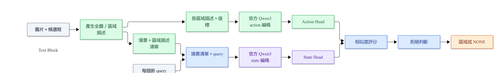
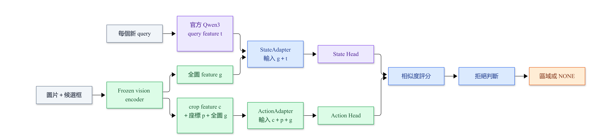
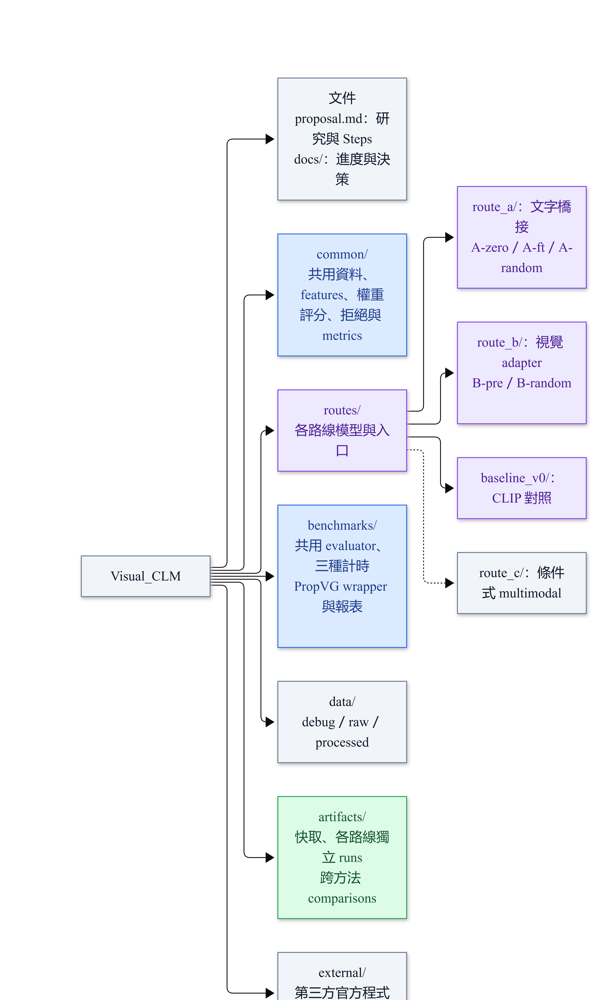
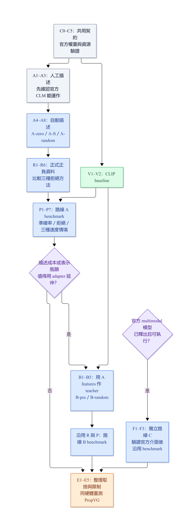

# Ground-or-Abstain：以官方 CLM 權重延伸視覺定位

> 更新：2026-10-04。將官方 CLM 的預訓練決策能力延伸到「候選區域／NONE」選擇，評估定位、拒絕與速度的取捨。優先驗證同圖多 query 的表示重用；不預設準確率或速度一定超過 PropVG。

## 1. 研究切入點與已確認的限制

輸入圖片 I、描述 Q 與候選框 R，輸出一個區域或 `NONE`。第一階段只處理**單一目標或無目標**，先用 GT candidates，再換 detector proposals。

- **RQ1：權重轉移。** 官方 heads 初始化是否比相同架構的隨機初始化更有用？
- **RQ2：可靠拒絕。** 在維持正例定位能力下，NONE prototype、threshold、groundability head 哪種取捨較好？
- **RQ3：效率。** 準確率未超過 PropVG 時，是否能在首次／同圖多 query 提供可用的延遲或顯存優勢？

**官方權重限制：** [CLM-8B 模型卡](https://huggingface.co/Contrastive-LM/CLM-v0.1-8B)說明它是 frozen Qwen3-8B＋state／action heads；heads 依賴該 encoder 的 last-token-pooled embeddings。不能直接接 CLIP features，維度一致也不代表表示空間相同。官方另預告多模態版本，但本計畫先以已公開的 8B 文字版驗證。

**研究新穎性待確認：** [GREC／gRefCOCO](https://github.com/henghuiding/gRefCOCO)已涵蓋無目標定位；[PropVG](https://arxiv.org/html/2509.04833v1)結合候選評分、對比學習與目標存在判斷；[VGent](https://arxiv.org/abs/2512.11099)也採 proposal selection。貢獻須來自官方權重轉移、可重用表示或實測取捨；重新命名為 state／action 不足以證明新穎性。

**速度假設邊界：** [CLM 官方結果](https://github.com/Contrastive-LM/CLM#results)的最高約 9× 加速是相對 Jev 的特定任務，受候選數與快取影響。PropVG 本身也研究效率，不能直接套用該倍率，或把不同硬體的論文延遲當作公平比較。

## 2. 路線選擇與模型流程

| 路線／代號 | 視覺如何接入？ | 官方權重與訓練 | 用途／限制 |
|---|---|---|---|
| **A：文字橋接，優先做** | 圖片／crop → 場景與區域描述；state=場景＋query，action=區域描述＋座標；均由 Qwen3 編碼 | A-zero：官方 heads 不更新；A-ft：官方 heads 初始化後微調；A-random：相同 heads 隨機初始化後同條件訓練 | 最容易確認官方權重真的有作用；描述遺漏／幻覺與生成成本可能成為瓶頸 |
| **B：視覺 adapter，後續分支** | 全圖 features＋Qwen query embedding → StateAdapter；crop＋座標＋全圖 → ActionAdapter；對齊官方 head 輸入 | B-pre：訓練 adapters，官方 heads 凍結；B-random：相同 adapters 配隨機且凍結的 heads | 推論移除場景／crop 描述生成；**新 query 仍需 Qwen 編碼**；對齊與關係理解待驗證 |
| **V0：CLIP 對照** | CLIP text–crop matching；V0-head 加全圖／位置與 trainable heads | 不使用官方 CLM 權重 | 判斷額外成本是否有幫助；不能代表官方權重轉移成果 |
| **C：未來官方 multimodal checkpoint** | 使用實際釋出模型的原生視覺／語言輸入 | 釋出後另驗證權重、介面與資源 | 條件式替代路線；不是目前依賴，不假設能在 4060 運行 |

**圖解：** A／B 推論、實作順序與資料夾分工分開呈現，見 [圖解說明與圖片](docs/diagrams/README.md)。圖片統一保存在 `docs/diagrams/`。

### A 推論流程



### B 推論流程



### A：先驗證權重轉移與重用

場景／區域描述必須**與 query 無關**，只描述圖中事實，不含正解、groundable label 或資料集原始 referring expression。state 的場景資訊包含全圖描述與固定排序的「region ID／描述／normalized xyxy」清單，再加 query；action 例如 `Region 3: red cup; box: ...`。讓 state 可見其他物件與位置，但是否能理解關係仍待驗證。模板、順序與 tokenizer recipe 寫入設定；超過 token budget 的處理在 val 階段固定並記錄，不靜默截斷。

先用 20 個正例的人工場景／區域描述確認流程，另加 20 個人工確認負例測拒絕。**人工描述僅供 oracle debugging，不能作自動端到端速度或泛化證據。** 正式資料換成 query-independent captioner；同圖描述與 actions 可重用，每個新 query 的 state embedding 仍重新計算。

沿用官方 encoder、pooling、normalization 與 head loading。[已固定版本的官方 heads.py](https://github.com/Contrastive-LM/CLM/blob/bb42c6c5bf914fd449bed2f6ca65be80602cb1f7/src/clm/heads.py)使用 4096 維 encoder features，輸入維度 Dh 與投影維度 d 均從 checkpoint／官方設定讀取；C0 查核本次發布權重為 Dh=4096、d=512。保留 `logit_scale`，`z_i = min(exp(logit_scale), 100) × cosine(S,A_i)`，API temperature 固定 1，不再重複除訓練 temperature。固定 revision、checkpoint hash、pooling／token recipe 與未重現界線見 `docs/decisions.md` 的 C0 紀錄。

### B：將描述生成移到訓練階段

初期 vision encoder 固定 `openai/clip-vit-base-patch32`。g、c 是 normalized Dv 維全圖／crop features；t 是官方 recipe 的 Dh 維 Qwen query feature；p 是四維 normalized box。

- StateAdapter：`concat(g,t) → Linear(256) → ReLU → Linear(Dh)`。
- ActionAdapter：`concat(c,p,g) → Linear(256) → ReLU → Linear(Dh)`。
- Teacher 是 A 的、**heads 之前**的 state／action embeddings。`L_align = (1-cos(eS_hat,eS_teacher)) + mean_i(1-cos(eA_hat_i,eA_teacher_i))`，N=0 時省略 action 項。先做 alignment，再加入正例 candidate CE；`L = L_rank + L_align`，初始 alignment weight=1，後續只在 val 調整。輸出遵循 teacher 的輸入正規化方式。
- 初版凍結 encoder 與 heads，只訓練 adapters。B-random 保持同 teacher、adapter 初始化、loss 與預算，只換凍結 heads；若之後解凍 heads，另補相同訓練條件的隨機初始化對照。

**【待驗證】** 這是 adapter 的起始假設，輸出 4096 維不證明已對齊。須降低 alignment loss 且改善 held-out ranking。全圖 pooled features 可能不足以處理關係，必要時另拆 region-context attention 實驗。

## 3. 資料、訓練與拒絕契約

正例起步用 [RefCOCOg UMD split](https://github.com/lichengunc/refer)，同圖 COCO instance boxes 作 candidates，包含 target 且按 annotation ID 排序。拒絕資料調查 gRefCOCO 的單目標／無目標子集及 RefCOCOg_rej；[GroundingME](https://groundingme.github.io/)作外部診斷。

**每個 protocol 固定 dataset、split 與 subset IDs。** 不同資料集可能共用 COCO 圖片，需跨資料集檢查 train／val／test image IDs。不相容 splits 時固定自訂 image-disjoint subset 並標明，不能直接比較原論文數字。初版排除多目標／歧義；全量 GREC 需另加多目標輸出與官方 evaluator。

樣本欄位：`sample_id, image_id, image_path, query, boxes, candidate_ids, groundable, gt_box, target_index, split`。boxes／gt_box 是 pixel xyxy。無目標時 gt_box／target_index=null；proposal 漏檢保留 groundable=true、gt_box，target_index=null、reason=`proposal_miss`，不當語意負例訓練。N=0 輸出 NONE、reason=`no_candidates`；有目標仍算端到端錯誤。

正例 objective 為同圖 candidate CE：`L_rank = -log softmax(z)[target_index]`，屬簡化 CLM-style adaptation，不宣稱重現官方完整雙向 InfoNCE／三階段預訓練。Hard negatives 僅從 train 同圖錯誤框 mining，排除有效等價目標；評估用完整固定候選集。

| 拒絕方法 | 初版訓練／決策 | 校準與公平比較 |
|---|---|---|
| Threshold | 固定 ranker；max cosine < δ 時拒絕 | 混合正負例 val 選 δ，test 不調參 |
| NONE prototype | 固定 ranker，學 normalized d 維 NONE vector；無目標映射最後候選 N，對 N+1 logits 做 CE | 初版不更新 ranker；用 NONE–最高區域的 margin 比較 operating points |
| Groundability head | 固定 ranker，`S → Linear(64) → ReLU → Linear(1)`；BCE 正例=1、負例=0 | 概率門檻由 val 決定；存在資訊是否足夠待驗證 |

三者使用相同正例 ranker checkpoint、split／candidates／負例。Threshold 只用負例校準，另兩者用於訓練，須揭露差異。val 預設最大化正例 Acc@0.5 與負例 rejection accuracy 的平均；另一 operating point 在 val 的 FRR≤5% 約束下最小化 FAR。門檻固定後報 test 的實際 FRR／FAR，若 test 超過 5%，不宣稱滿足該限制，也不回頭用 test 重選門檻。

起始訓練：batch=1、Adam；A heads learning rate=1e-4，B adapters／V0-head／拒絕模組=1e-3，最多 50 epochs。這些是假設，正式比較前由 val 固定；初始化對照的步數與搜尋預算相同。先 seed=42，主要結果再跑 42／43／44，報 mean±std。

## 4. Benchmark 與論文對照

| 實驗 | 比較與目的 | 核心結果 |
|---|---|---|
| E1：權重是否有效 | A-zero／A-ft／A-random；同 encoder、描述與 candidates；另列 V0／V0-head | 正例 Acc@0.5、candidate top-1；V0 與 A 的差異不能單獨歸因於權重 |
| E2：拒絕取捨 | 同 ranker 的三種拒絕方法 | 正例 Acc@0.5、rejection accuracy、FAR、FRR、拒絕 AUROC |
| E3：adapter 可行性 | B-pre vs B-random；另列 A 的文字橋接結果 | alignment loss、E1／E2 指標；teacher／captioner 的離線訓練成本另記 |
| E4：完整定位 | GT 換實際 proposals；A／B／V0 與可運行的 PropVG checkpoint | Proposal recall@0.5、端到端定位／拒絕；不加入 GT target |
| E5：效率 | 下表三種 protocol；cached／uncached 對照 | p50／p95 latency、queries/s、峰值顯存、T_total(Q) |

正例 Acc@0.5 分母含所有 groundable queries，拒絕與漏檢都算錯；rejection accuracy／FAR 是無目標的拒絕／接受比例；FRR 是正例拒絕比例。AUROC 以無目標為 positive，用 `-max cosine`、NONE margin、`1-P(groundable)` 作連續拒絕分數。

### 速度 protocol：界定完整計時範圍

| Protocol | 情境 | 計入哪些成本？ |
|---|---|---|
| P1：新圖首次 query | 模型已載入，沒有該圖快取 | 前處理、detector、A 的描述生成、所有編碼／adapter、scoring、拒絕與資料搬移 |
| P2：同圖 Q 次 queries | Q=1／5／20；僅 query-independent 圖片／actions 可重用 | 從新圖到全部 Q 個結果的 T_total(Q)，含一次快取建置；另列首筆、後續 query 延遲與每 query 平均成本 |
| P3：scoring only | 相同候選數，head 前 inputs 已可用 | projection heads、similarity、拒絕；另列 action projections 已快取情境。不能與對手完整系統時間混比 |

P2 對所有方法允許其實際支援的重用，記錄快取層級；**關閉 query／state embedding 的跨請求快取命中**，即使 latency 測試重複 query 文本也要重新編碼，以量測新 query 成本。PropVG 有文字條件的特徵互動，不能把 query-dependent features 當可快取，也不能禁止它可合法重用的部分。測 CLM 優勢從多少 queries 才出現，或完全沒有優勢。

計時起始規格：batch=1；warm-up 20 次後清除圖片快取，測至少 100 個完整 query／image streams；CUDA 計時前後 synchronize，統計整條流程的峰值顯存。下載／模型載入另記。N 比較上限 10／50／100，報實際 N，不複製框補數。同圖 queries 不足 Q 時，latency 可循環該圖的既有 queries，但須標示，不把重複 query 充作 accuracy 樣本。

公平對照：

- **完整系統：** 同硬體、同 image／query subset、同單目標／無目標定義，重測 [PropVG 官方 checkpoint](https://github.com/Dmmm1997/PropVG)。各自保留實際 proposal pipeline，成本全計；PropVG 的拒絕門檻也以同一 val／準則校準，不能只讓我方調參；記 input resolution、dtype／quantization、token 長度、runtime、候選數。
- **模組診斷：** A／B／V0 用相同 external proposals 比較 scoring。PropVG 無法接相同候選介面時只做完整系統比較，不假稱條件相同。
- VGent／autoregressive MLLM 為資源允許時的次要 baseline。paper-reported accuracy／latency 另欄列出，不計跨硬體 speedup；GT-candidate 成績不與完整 detector 成績直接競爭。

**成功標準：** 評估 accuracy–latency 曲線是否提供新取捨。暫定若低於 PropVG，正例 Acc@0.5 降幅≤2 個百分點、且在相同 FRR≤5% 下 FAR 不更差，才稱「近似能力下的加速」；此容許值是研究假設，正式 test 前固定。差距更大時仍報曲線與適用場景，但不能主張能力相當。只改善 P2，結論就限於同圖多 query。

## 5. 專案管理架構


# 實際個別檔案可以依情況調整
採用**共用模組＋各路線獨立實作＋統一 benchmark**。以下是目標架構，依 Steps 逐步建檔；`route_c/` 等官方模型可用才建立。

```text
Visual_CLM/
├── README.md                  # 專案入口、閱讀順序與執行方式
├── initial_plan.md             # 原始想法
├── proposal.md                 # 研究方向、實驗契約與 Steps
├── docs/
│   ├── progress.md             # Step 狀態、完成證據、阻礙與下一步
│   ├── decisions.md            # 設計選擇、原因與變更紀錄
│   └── diagrams/               # 模型／流程／架構圖片與圖解說明
├── common/                    # A／B／V0 共用，不複製到各路線
│   ├── data.py / datasets.py / rejection_data.py
│   ├── regions.py / proposals.py
│   ├── clm_weights.py / qwen_features.py / vision_features.py
│   ├── scoring.py / train_ranker.py / abstention.py / metrics.py
│   ├── cache.py
│   └── scripts/probe_resources.py
├── routes/
│   ├── route_a/
│   │   ├── README.md / config.yaml
│   │   ├── text_bridge.py / captioner.py / pipeline.py
│   │   └── scripts/run_a_zero.py / fit_a.py
│   ├── route_b/
│   │   ├── README.md / config.yaml
│   │   ├── adapters.py / adapter_loss.py / pipeline.py
│   │   └── scripts/build_teacher.py / fit_b.py
│   ├── baseline_v0/
│   │   └── README.md / config.yaml / visual_heads.py / pipeline.py
│   └── route_c/                # 條件式路線
│       └── README.md / config.yaml / official_multimodal.py / pipeline.py
├── benchmarks/                # 所有路線共用測量與報表入口
│   ├── evaluate.py / propvg_wrapper.py
│   └── first_query.py / multi_query.py / scoring_only.py / report.py
├── data/
│   └── debug/ / raw/ / processed/    # 手工樣本／原始資料／統一 schema 與 subset IDs
├── artifacts/
│   ├── cache/                 # 描述、features 與 teacher；依版本與內容識別
│   ├── route_a/ / route_b/ / baseline_v0/ / route_c/
│   └── comparisons/           # 跨方法比較，記錄來源 run IDs
└── external/                  # 官方 CLM／PropVG 等第三方程式，固定 revision
```

同一行的多個檔名／資料夾代表同層項目，不是巢狀路徑。第三方模型仍用官方 loader；不用把大型權重複製到各路線。

管理規則：

1. **變體共用程式。** A-zero／A-ft／A-random 由 `routes/route_a/config.yaml` 的 model ID、初始化與可訓練模組選擇；B-pre／B-random 同理。不為每個變體複製資料夾。設定也記錄 dataset、seed、模型 revision 與 cache policy。
2. **每次實驗獨立保存。** 例如 `artifacts/route_a/A-ft_seed42_20261004T153000/`，保存 `config.yaml`（本次實際設定）、`manifest.json`、`predictions.jsonl`、`metrics.json`，訓練時另存 checkpoint。相同設定重跑也用新 run ID，避免覆蓋；benchmark 另存 protocol 與計時明細。
3. **文件各有責任。** `proposal.md` 是研究與 Steps 的依據；`docs/progress.md` 記每步未開始／進行中／完成／受阻、證據路徑與下一步；路線 README 說明用途與指令；`docs/decisions.md` 記決策原因。跨路線結果放 `artifacts/comparisons/`，引用原始 runs，不複製成另一份無來源結果。
4. **統一推論介面。** 各路線的 `pipeline.py` 提供 `prepare_image(image)` 與 `predict_query(prepared, query)`，輸出相同 prediction schema，讓 benchmark 不依賴路線內部細節。PropVG 經 `benchmarks/propvg_wrapper.py` 適配；它可重用的內容依官方實作決定，不強迫拆成我方模型流程。
5. **兩台電腦可交接。** 資料／模型位置由設定指定，資料紀錄使用相對路徑；C4 保存依賴版本與硬體資訊。使用 Git 時，程式、設定與文件納入版本管理；大型資料、權重、快取與實驗產物不提交，另記取得方式與 hash。

步驟對應：C＝共用準備；A／B／V＝各路線；R＝共用資料與拒絕；P＝路線 pipeline＋統一 benchmark；F＝條件式路線 C。**Step C 與 route C 是不同概念**，以下每步列出實際檔案位置。

## 6. 小步驟實作順序
# 如果實作途中有發現任何需要修正的步驟，跟使用者討論後可以直接更改以下內容

每個 checkbox 是一次工作，預估新增 **20–60 行核心 Python**(不用嚴格執行)；閱讀／設定可為 0 行，超過就拆 a／b。每步先確認 shape／一個手工結果，再跑完成檢查。`common/` 放共用功能、`routes/` 放路線實作、`benchmarks/` 放評估入口、`artifacts/` 放產物；逐步建檔，不先產生全部空殼。完成一步就更新 `docs/progress.md`，並附可重跑指令與證據。

### 共用準備：目前 CPU 電腦可先做 C0–C3

| Step | 本次功能／檔案與介面 | 完成檢查 |
|---|---|---|
| [x] C0 | 讀官方 recipe／heads／ranking；在 `docs/decisions.md` 記 revision、checkpoint hash、Dh／d、pooling、logit_scale | 區分 encoder 與 heads；確認來源，未執行就標未重現 |
| [x] C1 | `common/data.py`：`load_samples(path)`，建立 20 正＋20 負 JSONL／圖片 | 座標、groundable／gt_box／target_index 一致；負例人工核對 |
| [ ] C2 | `common/regions.py`：`crop_regions(image, boxes)`，畫原圖框 | 裁切位置正確；空候選回空列表；非法框報錯 |
| [ ] C3 | `common/scoring.py`：`cosine_scores(s, actions) -> Tensor[N]`，先用手工向量 | 最相似排第一；candidate 順序對應，N=0 回空分數 |
| [ ] C4 | `common/scripts/probe_resources.py`：在 4060 測 encoder 載入／單次 embedding，固定環境 | 記顯存／runtime；跑不動先在其他機器產生官方 embeddings，head-only 時間不當完整 inference |
| [ ] C5 | `common/clm_weights.py`：官方 loader＋`project(state_e, action_e) -> (S,A,scale)` | Dh／d 從設定讀取；權重與 normalized outputs 正確，shape 錯就報錯 |

### 路線 A：得到真正使用官方 weights 的第一個結果

| Step | 本次功能／檔案與介面 | 完成檢查 |
|---|---|---|
| [ ] A1 | `routes/route_a/text_bridge.py`：`render_state(scene, query)`／`render_action(region, box)`；先用人工描述 | 不含 target／label；換 query 不改 scene／actions；超長文字按已記錄規則處理 |
| [ ] A2 | `common/qwen_features.py`：`embed_texts(texts) -> Tensor[K,Dh]`，沿用官方 recipe | 相同文字的本地 scores 與官方 ranking 在容差內相符；否則查 pooling／tokenization／normalization |
| [ ] A3 | `routes/route_a/scripts/run_a_zero.py`：串 A1／A2／C5／C3，跑 A-zero | 預測可重現；人工描述結果標 oracle |
| [ ] A4 | `routes/route_a/captioner.py`：`describe_scene(image)`／`describe_crop(crop)`，包裝 C4 實測可用 captioner | 與 query 無關；存 revision／prompt／token budget；抽查幻覺，不用 GT query 生成描述 |
| [ ] A5 | `common/cache.py`：存描述、Qwen head 前 features、action projections | key 含 image／box／模板／encoder／heads revisions；權重／前處理變更使舊快取失效 |
| [ ] A6 | `common/datasets.py`：轉 RefCOCOg UMD 正例與 COCO candidates，先約 1,000 筆 train＋獨立 val | GT target 在候選中；image IDs 不跨 split；label 不進入描述 |
| [ ] A7 | `common/train_ranker.py`：positive candidate CE，單次 optimizer step；encoder 特徵快取 | heads 更新、encoder 不變；loss 降低；scale 不重複套用 |
| [ ] A8 | `routes/route_a/scripts/fit_a.py`：A-ft／A-random，先 20 筆 overfit 再正式 subset | 同架構／scale 初值／資料／步數，只有 heads 初始化不同；val 選 checkpoint；未學會先查梯度／資料 |

### V0：低成本對照，也提供 B 的 vision features

| Step | 本次功能／檔案與介面 | 完成檢查 |
|---|---|---|
| [ ] V1 | `common/vision_features.py`：CLIP frozen `encode_images`／`encode_texts`；跑 crop–text baseline | shape [K,Dv]、同候選集、無 encoder 梯度；圖像與文字可分兩步 |
| [ ] V2 | `routes/baseline_v0/visual_heads.py`：V0-head，state=[global,text]、action=[crop,position]，各為 MLP(input→256→256)，中間 ReLU、輸出 L2 norm、τ=0.07 | 同正例 subset／預算訓練；backbone 與 A 不同，不當官方權重消融 |

### 拒絕與資料：先在 A 跑，再沿用到 B

| Step | 本次功能／檔案與介面 | 完成檢查 |
|---|---|---|
| [ ] R1 | `common/rejection_data.py`：接拒絕資料，選單目標／無目標 subset，存 IDs | 跨資料集 image 洩漏檢查；proposal_miss 不改成無目標；資料不可用就標受限 |
| [ ] R2 | `common/metrics.py`：Acc@0.5、candidate top-1、FAR／FRR／rejection | 全接受／全拒絕／正確框／錯誤框確認分母；正例拒絕算錯 |
| [ ] R3 | `common/abstention.py`：`calibrate_threshold(val_cosines, groundable, rank_correct)` | val 選預設平均準則與 FRR≤5% 門檻，test 不調參 |
| [ ] R4 | 同檔加 normalized d 維 `NonePrototype`；fixed ranker 的 N+1 CE | 無目標映射 N，不用 -1 當框索引；只有 NONE vector 有梯度 |
| [ ] R5 | 同檔加 `GroundabilityHead(S) -> scalar logit`，BCE 訓練 | fixed ranker 不變；val 校準；輸入維度依模型 d |
| [ ] R6 | `benchmarks/evaluate.py`：重載模型／門檻，輸出逐筆結果與 AUROC／operating curves | E1／E2 正負分項；oracle／automatic 分列；結果可重算 |

### 路線 B：A 自動描述結果完成後，依瓶頸決定是否做

| Step | 本次功能／檔案與介面 | 完成檢查 |
|---|---|---|
| [ ] B1 | `routes/route_b/scripts/build_teacher.py`：A 的 train／val eS／eA；另存 query-only t、g／c／p | teacher 是 head 前 features；state 含 query、action 不含；vision／teacher candidate IDs 一致 |
| [ ] B2 | `routes/route_b/adapters.py`：`StateAdapter(g,t) -> Tensor[Dh]` | shape／normalization 與 teacher 一致；仍保留 Qwen query encoder |
| [ ] B3 | 同檔加 `ActionAdapter(c,p,g) -> Tensor[N,Dh]` | 換 query 不改 actions；換候選順序只換輸出順序 |
| [ ] B4 | `routes/route_b/adapter_loss.py`：alignment＋接 frozen heads 的 candidate CE | loss 可降；backward 穿過 frozen heads，只有 adapters 更新 |
| [ ] B5 | `routes/route_b/scripts/fit_b.py`：B-pre／B-random，先 overfit 再正式 subset；沿用 R3–R6 | 同 teacher／adapter 初始化／預算，只有 frozen heads 不同；驗證 held-out E3 |

### 端到端與 benchmark：A、B 共用測量入口

| Step | 本次功能／檔案與介面 | 完成檢查 |
|---|---|---|
| [ ] P1 | `common/proposals.py`：`propose(image) -> boxes,ids`，選可運行的 query-independent detector | 格式與 GT 一致；固定 revision／threshold／N cap；空候選／漏檢另記 |
| [ ] P2 | `routes/<route>/pipeline.py`：`prepare_image(image)`／`predict_query(prepared, query)`，A／B／V0 各自包裝 | 新圖完整準備成本入帳；換 query 不改 actions；不插 GT target，算 proposal recall |
| [ ] P3 | `benchmarks/propvg_wrapper.py`：包裝官方 checkpoint，輸出共用 prediction schema | 沿用官方 config／存在判斷；事前固定單目標取最高分框規則，不用 GT 挑框 |
| [ ] P4 | `benchmarks/first_query.py`：P1 新圖計時，先 stage timers 再 p50／p95 | warm-up／CUDA synchronize；描述／encoder／detector 成本全列，各方法同硬體 |
| [ ] P5 | `benchmarks/multi_query.py`：P2 的 Q=1／5／20，cached／uncached | T_total 含首次建置，不預先藏在 artifacts；報合法 cache 命中與 break-even Q |
| [ ] P6 | `benchmarks/scoring_only.py`：P3，head 前 inputs／action projections 兩種 cache 範圍 | 與 P1／P2 分列；量 N／峰值顯存，不用此結果主張整系統更快 |
| [ ] P7 | `benchmarks/report.py`：E1–E5 CSV、accuracy–latency 曲線；主要訓練跑 3 seeds | paper-reported／本地重測分欄；指出 P1 或 P2 優勢，或沒有優勢 |

### 條件式路線 C：只在官方 multimodal 權重可取得時啟動

| Step | 本次功能／檔案與介面 | 完成檢查 |
|---|---|---|
| [ ] F1 | 查官方 release，保存 model revision、輸入介面與單次視覺 inference 的資源結果 | 可實際下載／執行才啟動，只有預告就維持待確認；不預設沿用 8B heads |
| [ ] F2 | `routes/route_c/official_multimodal.py`：依該版本官方介面包裝 image／query／region scoring | 先對齊官方範例，再接共用 prediction schema；若只能生成或 action 與 query 綁定，先記錄限制再調整實驗 |
| [ ] F3 | 沿用 R1–R6／P1–P7，新增獨立 model ID；若可分離 heads，再做其官方／隨機初始化對照 | 相同 subset、拒絕規格與計時；無等價初始化介面就另設計消融，不聲稱已隔離權重效果 |



## 7. 執行條件、未確定事項與交接

目前電腦無 GPU，可做 C0–C3；另一台 RTX 4060 的顯存待確認。8B BF16 權重粗估約 16 GB，尚未含 runtime；不足時 C4 驗證量化，或在其他機器產生 embeddings。**量化需重查相對原始權重的 score／accuracy 差異，不假設與未量化等價；CPU offload／跨機傳輸須計時；離線快取只支援訓練／P3，不能代替 P1／P2 的 encoder 成本。** 無法在同硬體跑雙方，完整速度比較暫列受限。

| 未確定問題 | 決策時點／目前假設 |
|---|---|
| 官方權重是否適合 grounding | A-zero／A-ft／A-random 的 E1 決定，不預設有效 |
| captioner、detector 與 4060 可行性 | C4／A4／P1 resource probe 後固定模型版本；先不安裝整套大型依賴 |
| adapter 是否保留關係資訊 | B2–B5 檢查 alignment／空間案例；失敗再拆 attention，不只增維度宣稱解決 |
| 拒絕資料／GroundingME candidates | R1 檢查；無完整候選標註就用 detector，不稱 oracle |
| 新 multimodal 模型與新穎性 | 執行前再查官方 release／相關工作；已有相同設計就重新界定問題 |

交接時先更新 `docs/progress.md` 的完成 Steps／下一步與 run 路徑；每次實驗的 `artifacts/<route>/<run_id>/manifest.json` 記錄 route／model ID、dataset／subset IDs、code／model revisions、checkpoint hash、描述模板、pooling／normalization、trainable modules、seed／超參數、hardware／runtime、cache scope、threshold、結果路徑。資料用相對路徑；逐筆保存 `prediction_index或NONE、reason、scores、IoU、groundable、latency`，供另一位實驗者重算結論。

**第一個里程碑是 C0–C5＋A1–A3：確認官方文字模型能對視覺描述所構成的 candidates 做決策。** 此時只回答權重／介面是否接通；自動描述、拒絕與 P1／P2 重測完成後才評估研究貢獻。A 與 B 是分階段選項，不要求一開始同時完成所有路線。
